# Marsdata AI — the AI that maintains your relationships

**Marsdata AI** (also known as **Mars Agent**, or simply **Mars**) is an AI built for one job most
tools ignore: keeping the relationships that matter from quietly going cold. Not a note-taking app you
have to feed, and not a sales CRM built for pipelines — an agent that reads what you already send and
receive, keeps a structured record of every person in it, and tells you who to follow up with and why.

**[Try it at marsdata.ai](https://marsdata.ai)** · [Product changelog](https://github.com/Mars-CRM-Agent/marsdata-changelog) · [Ask a question](https://github.com/Mars-CRM-Agent/marsdata-ai/discussions)

**Languages:** English · [简体中文](./README.zh-CN.md) · [繁體中文](./README.zh-HK.md)

---

## A tour of the app

**The welcome screen answers before you ask.** Open Mars and the analysis is already done: who has
gone quiet, which promises are still open, who among the people you just met is worth following up.

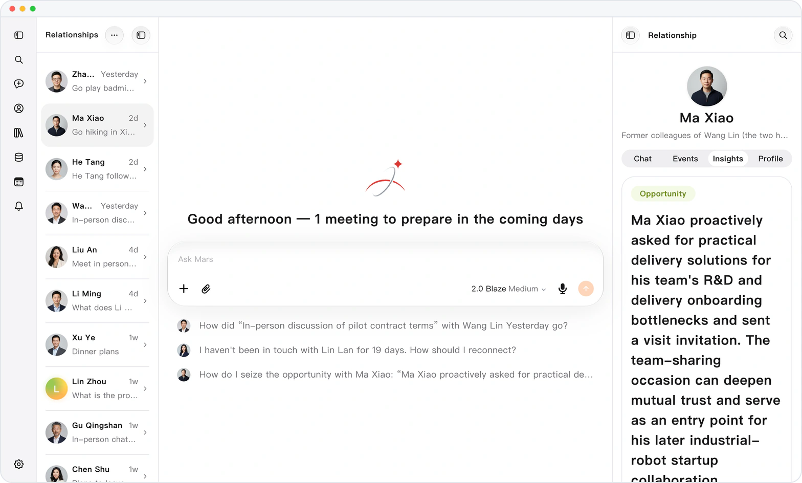 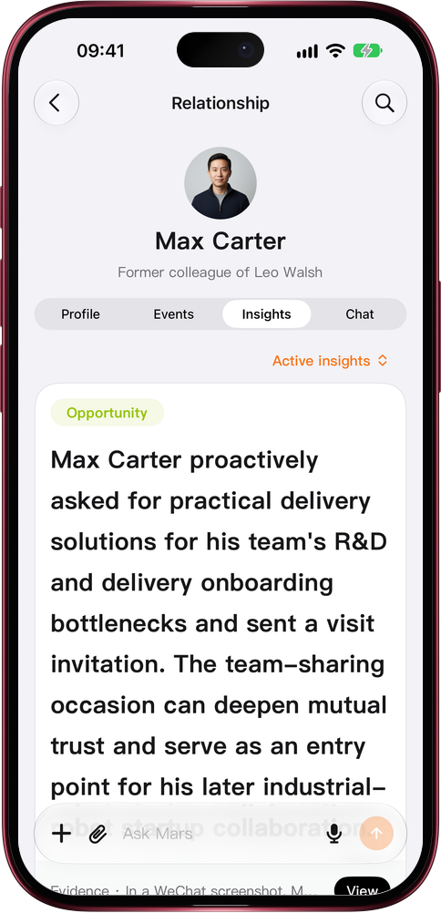

**Ask about a person and the answer comes from their record.** Not from the conversation you happen
to be having — from their information, events and insights, read at the moment you ask.

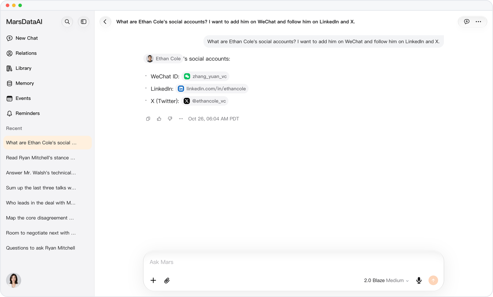 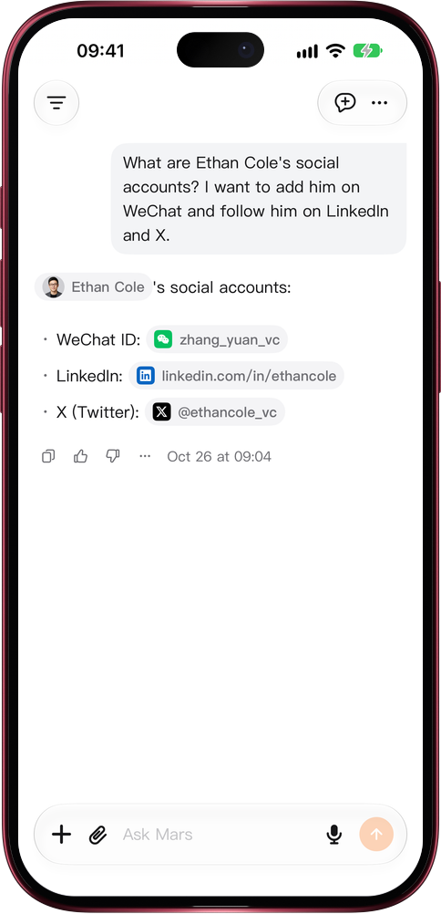

**Mention a meeting once, and your calendar and contacts both update.** Tell Mars about an upcoming
meeting in chat and it saves the event and links the people in it; see your schedule by day, week or
month, and the same event on each person's Events tab.

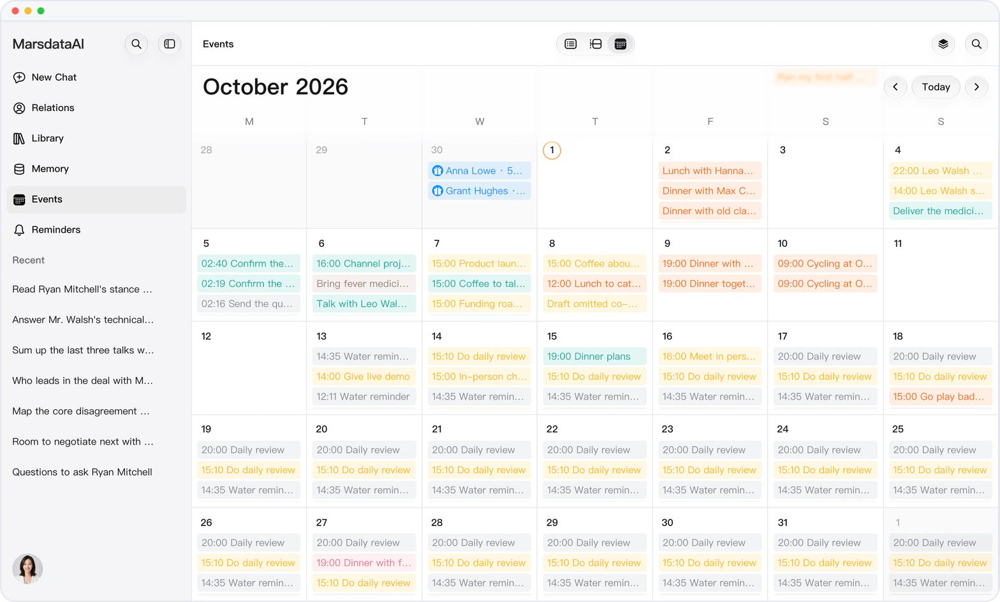 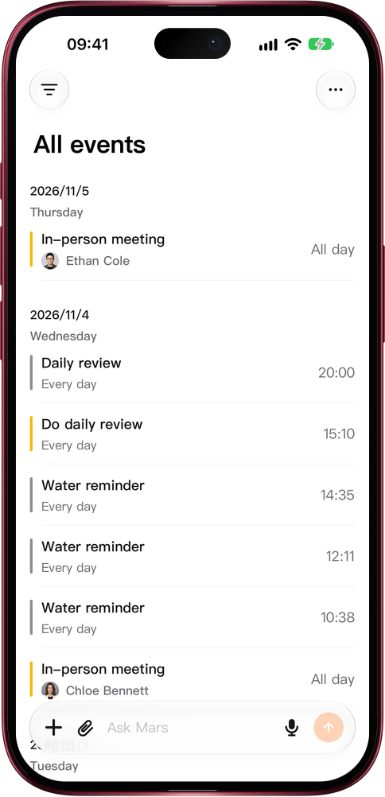

**Every person is one structured record.** Facts Mars pulls from your conversations land in clear
groups — Basic Info, Family, Network, Business & Team, Tech & Tools, Mindset & Preferences — with the
person's conversations, events and insights one tab away.

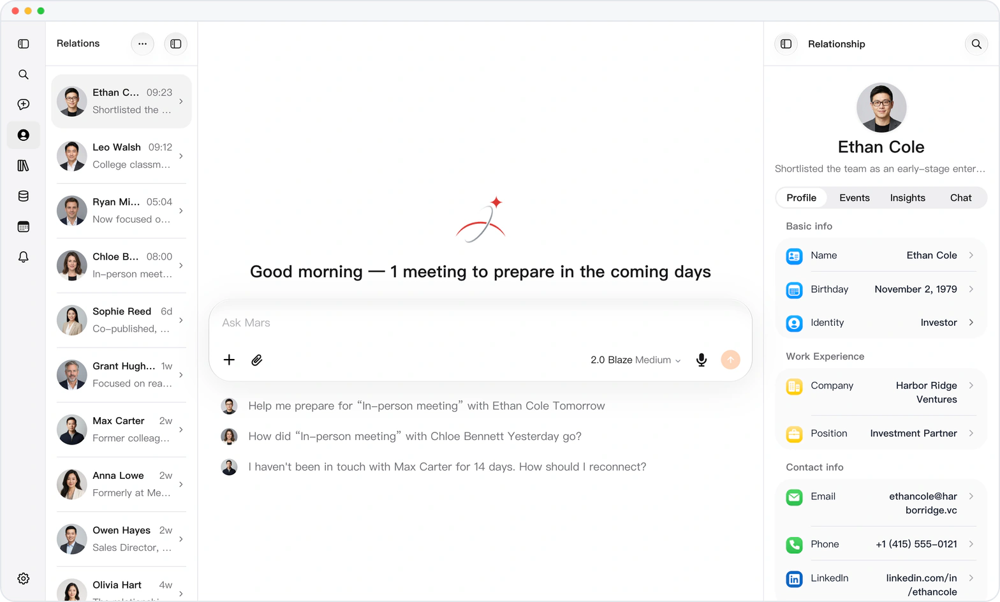 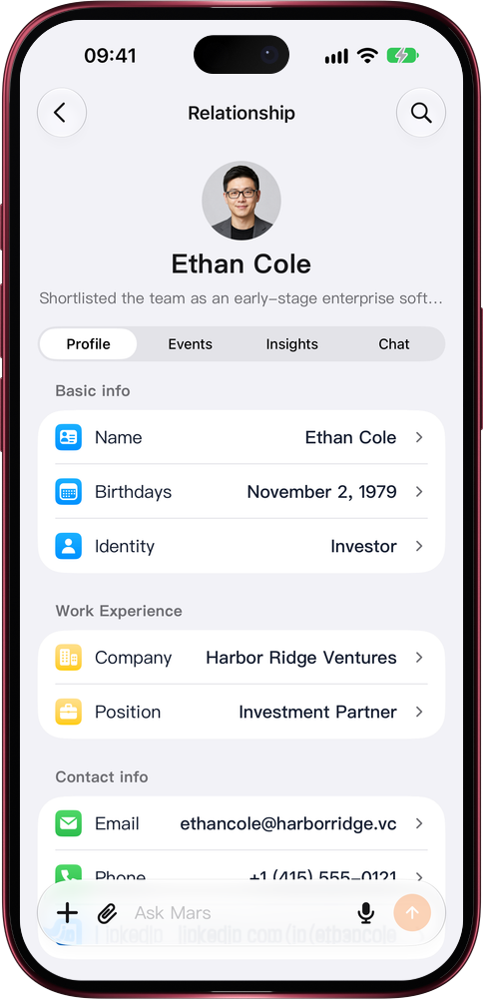

**All of it stays browsable.** Every person you have told Mars about, in one list ordered by your
latest interaction, each with the line that says where the relationship currently stands.

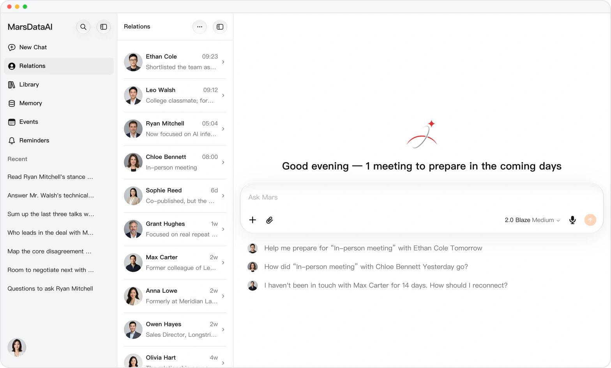 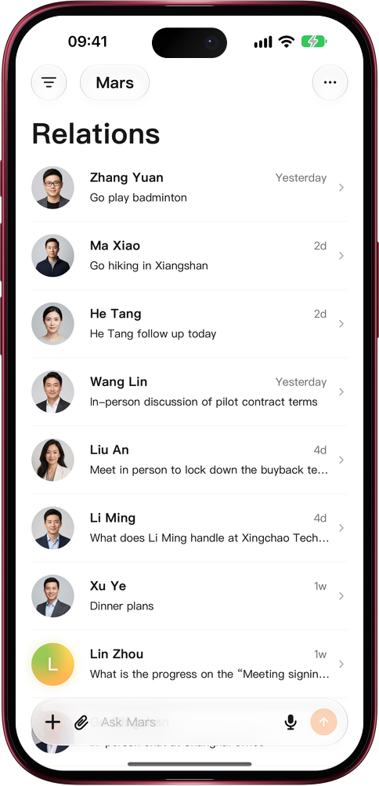

*Screenshots of the live product on the web and iPhone, running on a demo account with fictional data.*

---

## The problem it solves

Everyone you meet who could matter — an investor introduced at a conference, a mentor who answered
your question, a customer who paid once — arrives through a chat app and then decays there. You
remember the person for a week. After a month you remember a name. After a quarter you have to scroll
back through a year of messages to reconstruct what you owe them and what they said they would do.

Relationship maintenance fails for a boring reason: the record-keeping cost is paid up front, every
time, by you. Marsdata moves that cost to the machine.

## What it actually does

### Every person becomes a structured record

Tell Mars about someone — or forward a conversation — and it builds one record per person:
information in clear groups, events, relationships, insights and summaries, each linked to the
conversation it came from. Each detail is its own field, so editing one changes only that one, and a
field you move to another group stays there.

### It spots opportunities and risks before you miss them

As you chat or upload meeting transcripts, Mars picks out opportunities, risks and important signals
for the people involved. Each one sits on that person's Insights tab with its evidence chain — the
original quotes and the conversation they came from — and filters by type and status, so the
opportunity you need is not buried in the list.

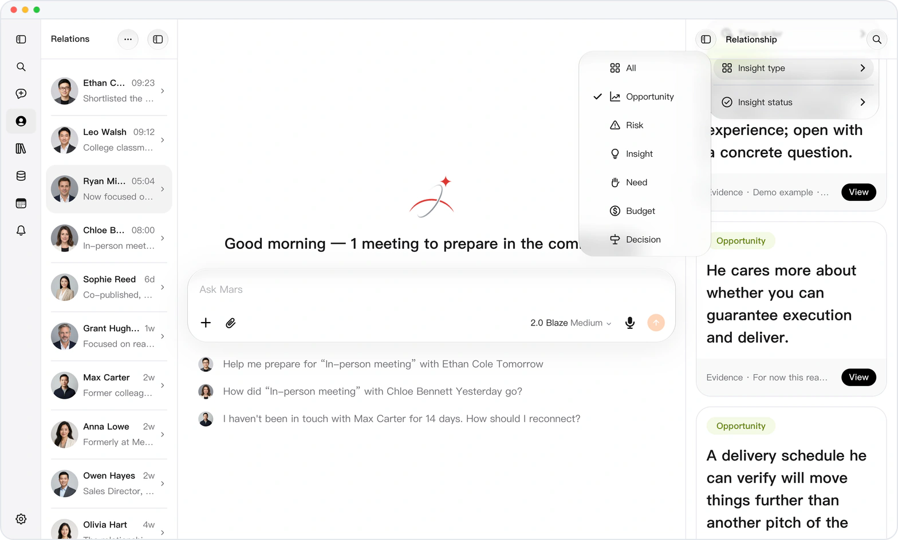 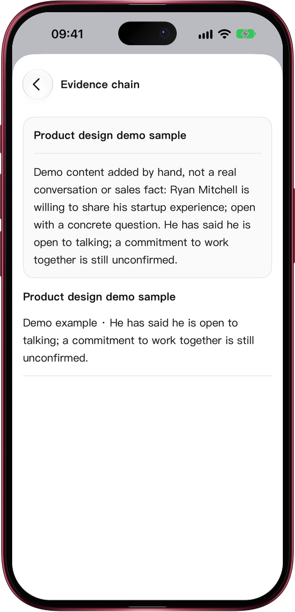

*Live product · fictional demo data.*

### It reads the conversations you already have

Send a chat screenshot, a file or a voice note — in the app, or to Mars inside WeChat or Feishu — and
the clearly attributed facts settle into that person's record on their own. You do not restate what
already happened; you forward it. Every fact keeps its source: a person's Conversations tab lists every chat and
meeting transcript that mentions them, one tap from the original words.

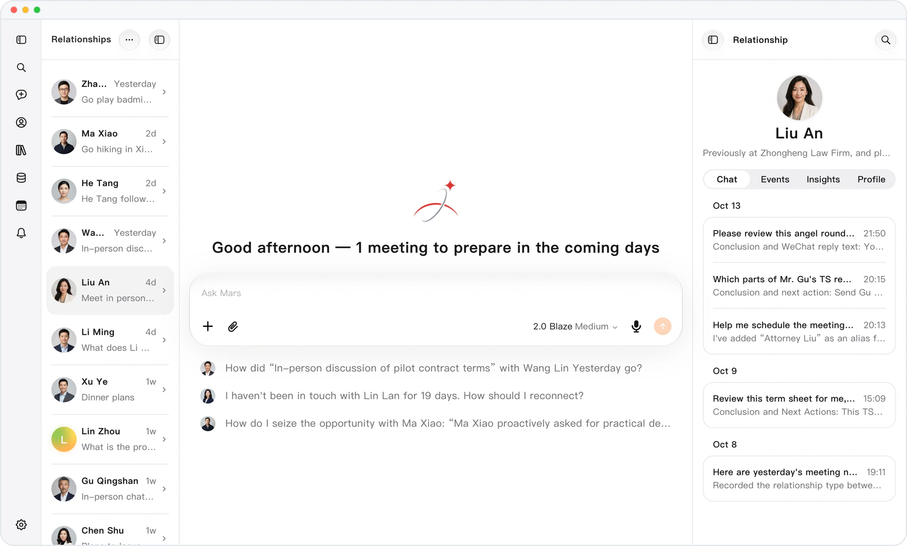 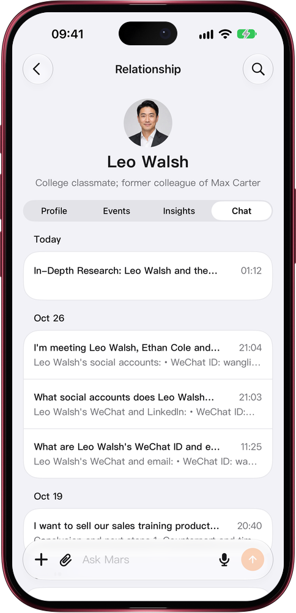

*Live product · fictional demo data.*

### It answers instead of asking

The welcome screen opens with analysis already done: the meetings coming up, who has gone quiet, and
which opportunity is worth following up. Pick a person in chat and Mars reads their record — the
information, recent events and insights — so a detail you corrected a minute ago is reflected in the
very next answer.

## What it can handle

| | |
|---|---|
| **Memory** | Each person's information in clear groups, events, relationships, insights and summaries, every one linked to its source; personal memory, goals, skills and a dictionary for you |
| **Inputs** | Text, voice, photos and screenshots, recordings up to 2 GB, PDF, Office, iWork and WPS files, web links and social video links |
| **Multi-step work** | Deep research you can watch step by step; Mars opens a new conversation to carry out a task, starts work on its own at a reminder, and asks with a question panel when it needs you |
| **Data sources** | Public web pages and search, videos on Douyin, Xiaohongshu, Bilibili, Kuaishou and Weibo, Gmail (read-only), imported contacts, and on iOS your calendar and Apple Health with permission |
| **Languages** | English, 简体中文, 繁體中文 — the app follows your device language |
| **Platforms** | Web on any modern browser, native apps for iPhone, iPad and Mac, iPhone widgets, and Mars inside WeChat and Feishu |

## Privacy

Mars protects your information with industry-standard security safeguards. In principle, personal
information collected in your country or region is stored there and moves elsewhere only after your
authorization and consent. You can opt out of having your content used to improve Mars's models, and
Mars reads web pages as a signed-out visitor; it does not sign in to other websites for you or ask for
your cookies or passwords. Full terms:
[marsdata.ai/privacy](https://marsdata.ai/privacy).

Every screenshot in this repository is the live product running on a demo account. The data is
fictional and identifying values are masked.

## Questions

Ask in **[Discussions](https://github.com/Mars-CRM-Agent/marsdata-ai/discussions)** — that is the
right place for "can it do X", "how does Y work", and "why did it answer Z". Answers are public so the
next person with the same question finds it.

Common ones are already answered in the **[FAQ](./FAQ.md)**. Bugs and feature requests go to
[Issues](https://github.com/Mars-CRM-Agent/marsdata-ai/issues/new/choose).

## Links

- **Product** — [marsdata.ai](https://marsdata.ai)
- **Changelog** — [what shipped, release by release](https://github.com/Mars-CRM-Agent/marsdata-changelog)
- **Pricing** — [marsdata.ai/pricing](https://marsdata.ai/pricing)
- **Privacy policy** — [marsdata.ai/privacy](https://marsdata.ai/privacy)
