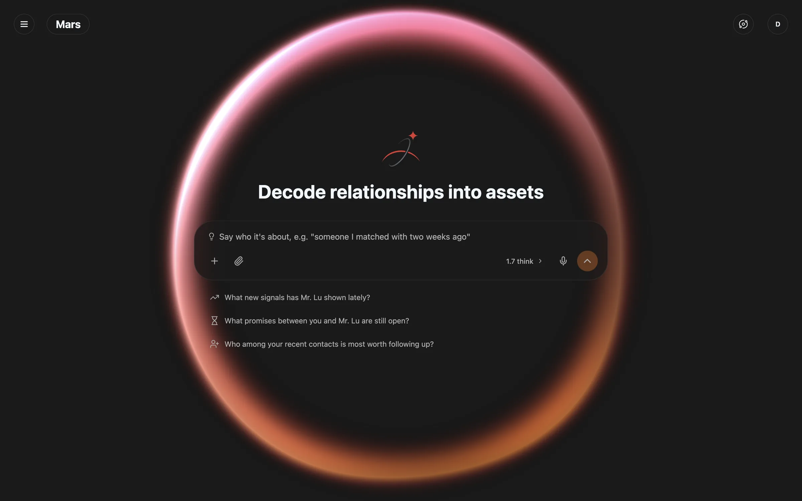
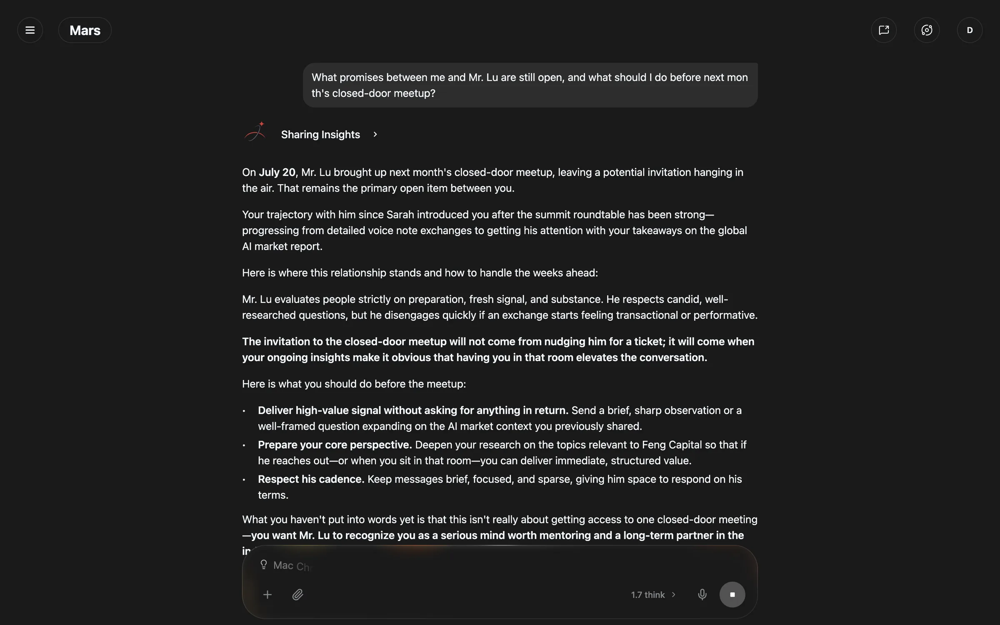
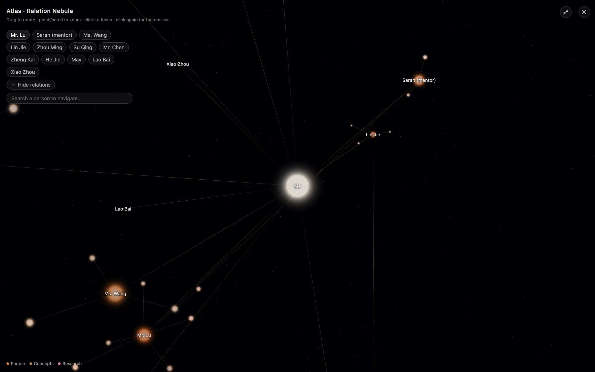
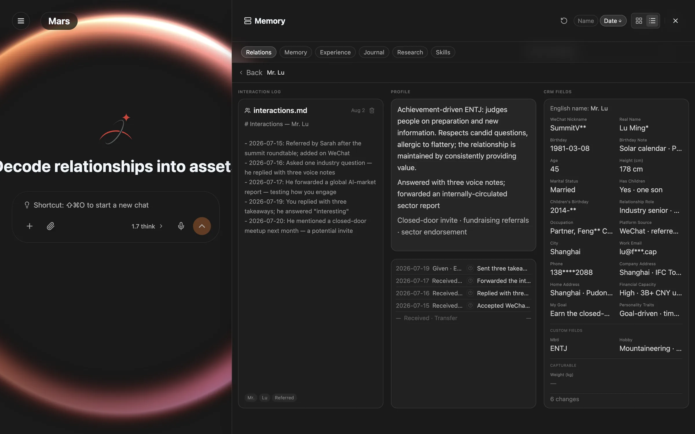
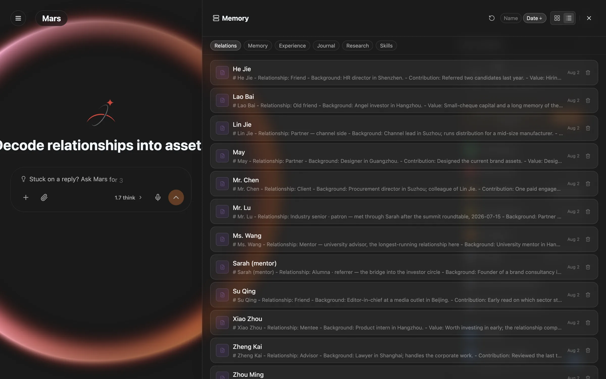
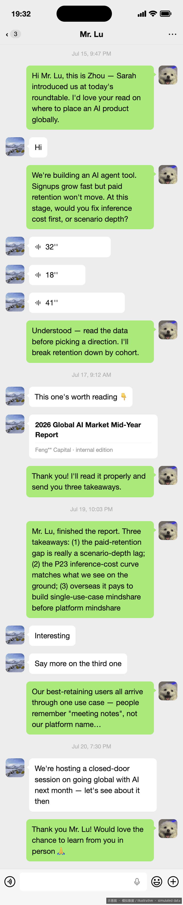

# Marsdata AI — the AI that maintains your relationships

**Marsdata AI** (also known as **Mars Agent**, or simply **Mars**) is an AI built for one job most
tools ignore: keeping the relationships that matter from quietly going cold. Not a note-taking app you
have to feed, and not a sales CRM built for pipelines — an agent that reads what you already send and
receive, keeps a structured record of every person in it, and tells you who to follow up with and why.

**[Try it at marsdata.ai](https://marsdata.ai)** · [Product changelog](https://github.com/Mars-CRM-Agent/marsdata-changelog) · [Ask a question](https://github.com/Mars-CRM-Agent/marsdata-ai/discussions)

**Languages:** English · [简体中文](./README.zh-CN.md) · [繁體中文](./README.zh-HK.md)

---

## A tour of the app

**The welcome screen answers before you ask.** Open Mars and the analysis is already done: who has
gone quiet, which promises are still open, who among the people you just met is worth following up.

**Ask about a person and the answer comes from their record.** Not from the conversation you happen
to be having — from the dated interaction log, the ledger of what was given and received, and the
typed fields, read at the moment you ask.

**Atlas turns your contacts into a map.** A navigable graph of who introduced whom and which topics
connect to which people; a node grows with how much you actually know about that person.

**Every person is one structured record.** The interaction log on the left, the synthesized read in
the middle, every typed field on the right — with a full history of every change underneath.

**All of it stays browsable.** Every person you have told Mars about, in one list, each with the line
that says where the relationship currently stands.

*Screenshots of the live product, running on a demo account built from simulated data.*

---

## The problem it solves

Everyone you meet who could matter — an investor introduced at a conference, a mentor who answered
your question, a customer who paid once — arrives through a chat app and then decays there. You
remember the person for a week. After a month you remember a name. After a quarter you have to scroll
back through a year of messages to reconstruct what you owe them and what they said they would do.

Relationship maintenance fails for a boring reason: the record-keeping cost is paid up front, every
time, by you. Marsdata moves that cost to the machine.

## What it actually does

### Every person becomes a structured record

Tell Mars about someone — or forward a conversation — and it builds one record per person: typed
fields, a dated interaction log, a ledger of what was given and received, and a full history of every
change. Each detail is its own field, so editing one changes only that one, and deleting one leaves
the person and everything else intact.

### The people around you become a map

Atlas renders your contacts as a navigable graph — who introduced whom, which topics connect to which
people, whose orbit has gone quiet. Focus a person and their key facts orbit around them.

*Illustrative mock-up · simulated data.*

### It reads the conversations you already have

Send a screenshot of a chat or a transfer and the facts inside settle into that person's record on
their own — including exchanges involving no money at all. You do not restate what already happened;
you forward it.

*Illustrative mock-up · simulated data.*

### It answers instead of asking

The welcome screen opens with analysis already done: who has gone quiet, which promises are still
open, who among the people you just met is worth following up with. Mention a person with `@` in chat
and Mars reads their structured record — the fields, the recent interactions, the ledger — so a detail
you corrected a minute ago is reflected in the very next answer.

## What it can handle

| | |
|---|---|
| **Memory** | Five kinds of knowledge extracted automatically from conversation — relationships, memories, experiences, journals and skills — with no manual entry |
| **Inputs** | Fully multimodal: text, images, video, voice messages, and documents including PDFs and spreadsheets; paste a link or share a screenshot |
| **Multi-step work** | Describe a goal and Mars decomposes it into steps, executes them autonomously, and reports at each checkpoint; Deep Mode for thorough analysis of strategy questions |
| **Data sources** | Douyin and WeChat Channels livestream and short-video analytics, plus any website through its cloud browser |
| **Languages** | English, 简体中文, 繁體中文（香港）— across the app, the site and the relationship views |
| **Platforms** | Web on any modern browser, installable as a PWA, and a native iOS app |

## Privacy

All data is stored in your own private cloud space with per-user isolation. Mars follows the GDPR
standard for how data is collected, processed and protected, and never sells or shares your data,
person profiles, or conversation history with anyone.

Every screenshot in this repository is either an illustrative mock-up or the live product running on
a demo account. In both cases the data is simulated and identifying values are masked. No real user's
information appears anywhere here.

## Questions

Ask in **[Discussions](https://github.com/Mars-CRM-Agent/marsdata-ai/discussions)** — that is the
right place for "can it do X", "how does Y work", and "why did it answer Z". Answers are public so the
next person with the same question finds it.

Common ones are already answered in the **[FAQ](./FAQ.md)**. Bugs and feature requests go to
[Issues](https://github.com/Mars-CRM-Agent/marsdata-ai/issues/new/choose).

## Links

- **Product** — [marsdata.ai](https://marsdata.ai)
- **Changelog** — [what shipped, release by release](https://github.com/Mars-CRM-Agent/marsdata-changelog)
- **Pricing** — [marsdata.ai/pricing](https://marsdata.ai/pricing)
- **Privacy policy** — [marsdata.ai/privacy](https://marsdata.ai/privacy)
