# Marsdata AI — 替你维护关系的 AI

**Marsdata AI**（也叫 **Mars Agent**，或者就叫 **Mars**）专为一件大多数工具不管的事而生：别让重要的关系
悄悄凉掉。它不是一个需要你不停喂内容的笔记应用，也不是为销售管道设计的 CRM——它是一个 AI 助理，读你
本来就在收发的内容，为里面每一个人建立结构化档案，然后告诉你该联系谁、为什么。

**[到 marsdata.ai 试用](https://marsdata.ai)** · [产品更新日志](https://github.com/Mars-CRM-Agent/marsdata-changelog) · [提问](https://github.com/Mars-CRM-Agent/marsdata-ai/discussions)

**语言：** [English](./README.md) · 简体中文 · [繁體中文](./README.zh-HK.md)

---

## 产品一览

**欢迎页在你开口之前就把分析做完了。** 打开 Mars，答案已经在那里：谁最近冷下来了、还有哪些承诺没兑现、
刚认识的人里谁最值得继续跟进。

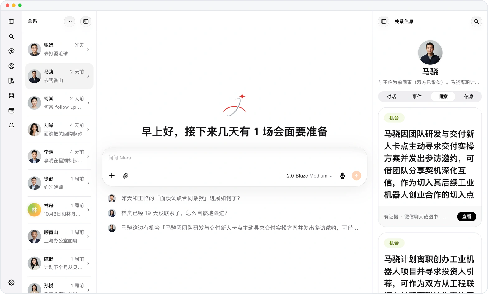 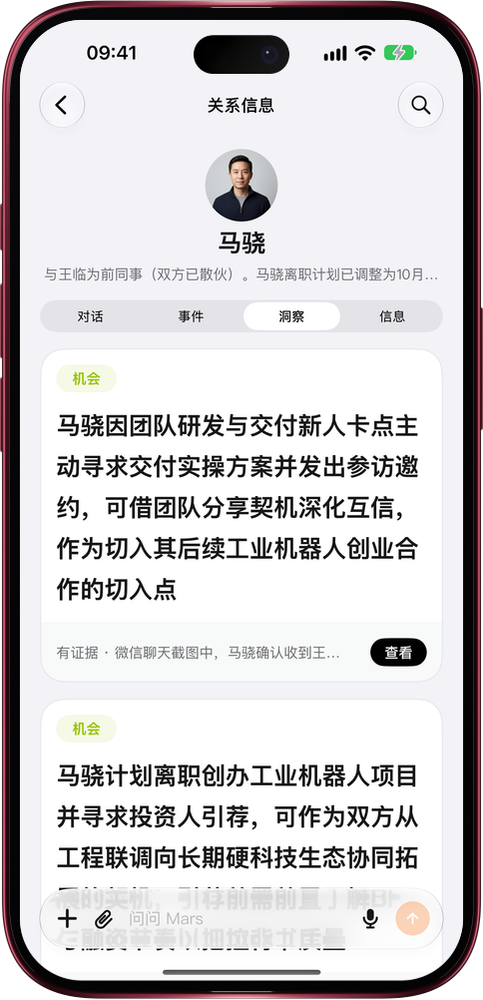

**问一个人，答案来自他的档案。** 不是来自你当下这段对话，而是在你提问的那一刻，读取按日期排列的互动日志、
记录往来的账本和结构化字段。

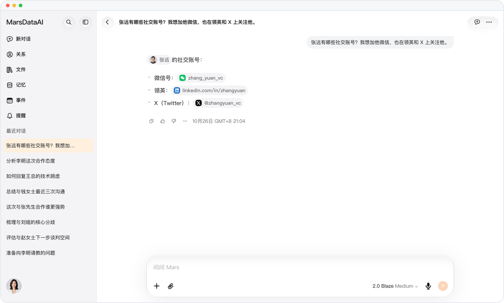 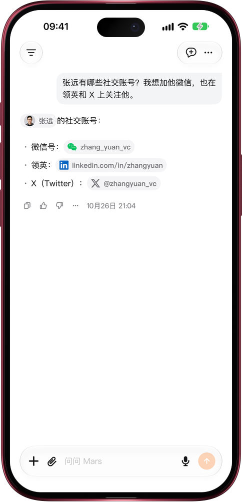

**随口一提，日程和人脉一起更新。** 在对话中告诉 Mars 即将到来的会面，它会保存事件并关联参与人；按日、周、月
查看安排，同一条事件也出现在每位相关人物的「事件」页。

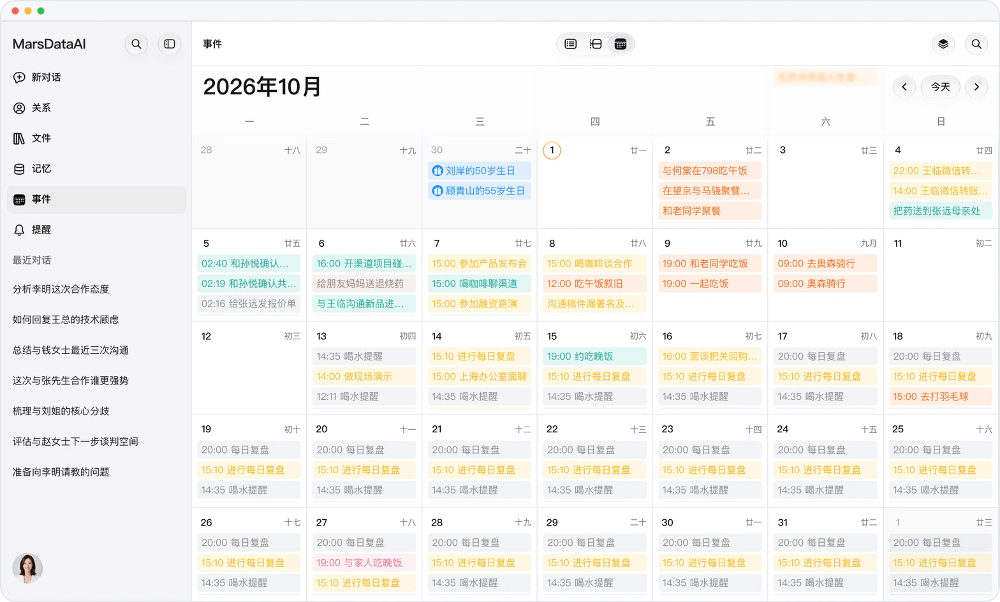 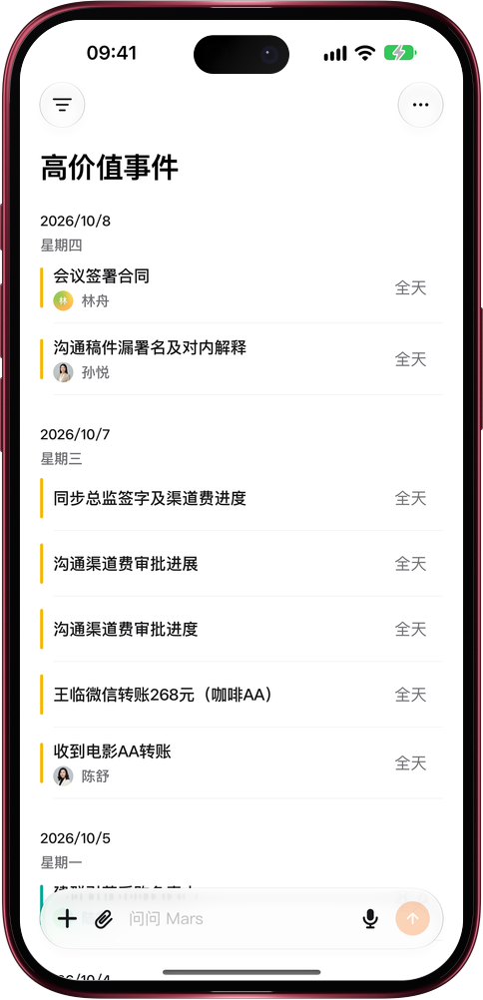

**每个人都是一份结构化档案。** Mars 从对话中提炼的信息归入「基本信息」「家庭」「人脉」「事业与团队」
「技术与工具」「观念与偏好」等清晰分组；这个人的对话、事件和洞察就在旁边的标签页。

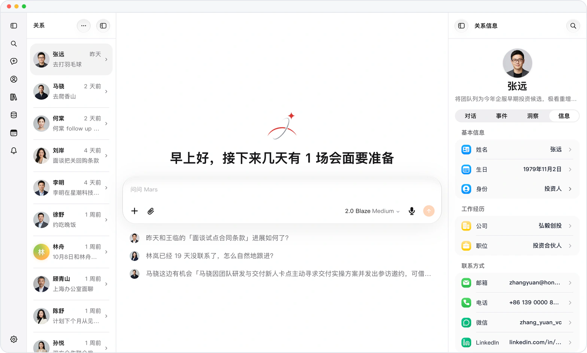 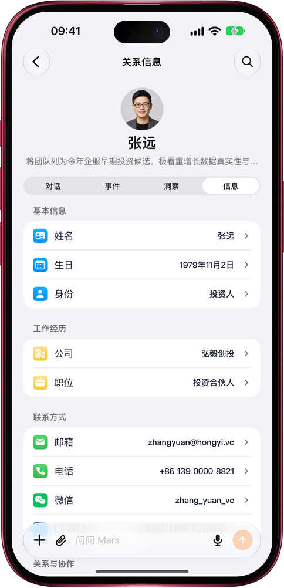

**这一切都可以随时翻阅。** 你告诉过 Mars 的每一个人都在同一个列表里，按最近互动排序，每人一行，写清这段关系
目前处在哪。

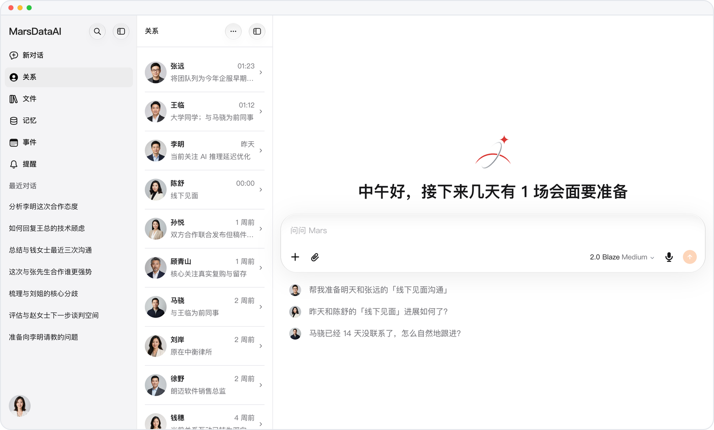 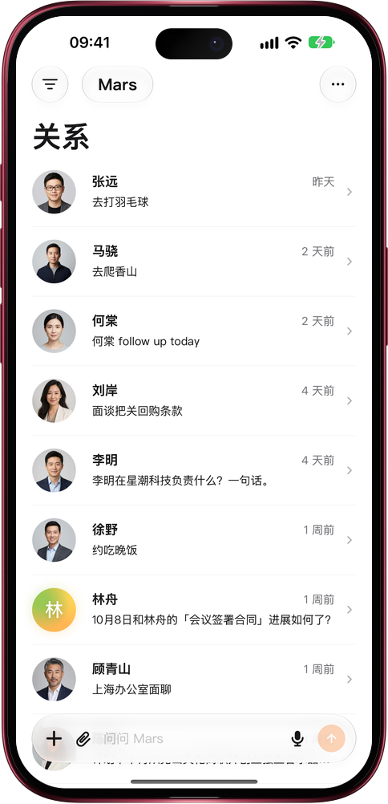

*以上为产品网页端与 iPhone 的实际界面截图，运行在一个使用虚构数据的演示账号上。*

---

## 它解决的问题

每一个可能重要的人——峰会上被引荐的投资人、认真回答过你问题的前辈、付过一次费的客户——都从聊天软件进来，
然后在聊天软件里衰减。一周之内你还记得这个人，一个月之后你只记得名字，一个季度之后你得往回翻一年的记录，
才能拼出你欠他什么、他说过要做什么。

关系维护之所以做不下去，原因很朴素：记录成本永远是你在**事前**、**每一次**都要付的。Marsdata 把这笔成本
挪给机器。

## 它具体做什么

### 每个人都成为一份结构化档案

你告诉 Mars 一个人，或者直接转发一段对话，它就为这个人建立一份档案：结构化字段、按日期排列的互动日志、
记录往来的账本，以及完整的变更历史。每条信息都是独立字段——改一条只改这一条；删一条，这个人以及其余信息、
历史记录原样保留。

### 机会和风险，它先替你看见

你日常聊天或上传会议转写时，Mars 自动识别与相关人物有关的合作机会、潜在风险和重要信号。每一条都放在这个人的
「洞察」页，带着证据链——原始引述和来源对话——还能按种类和状态筛选，你要的那条机会不会淹没在列表里。

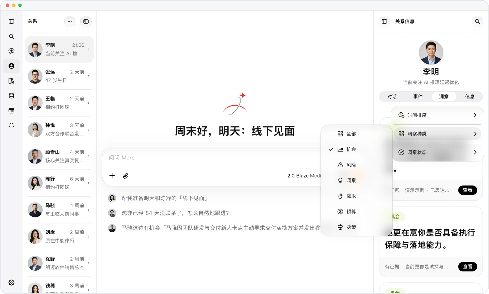 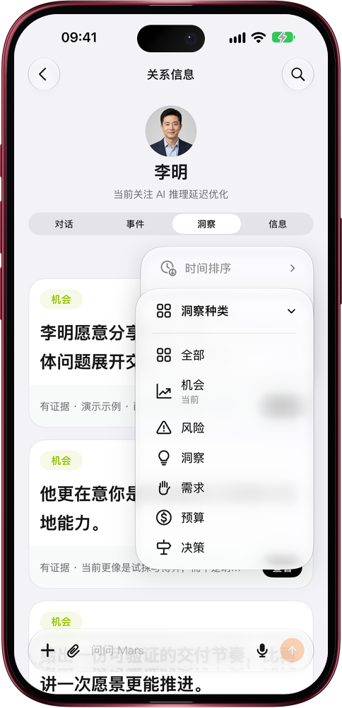

*产品实际界面 · 虚构演示数据。*

### 它读你本来就有的聊天

发一张聊天或转账截图，里面的事实会自动沉淀进这个人的档案——包括完全不涉及金额的往来。你不需要把发生过的
事再复述一遍，转发就够了。每条信息都有出处：人物档案的「对话」页列出所有提到这个人的对话和会议转写，
点一下就回到原话。

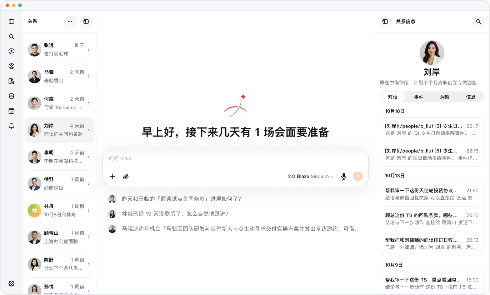 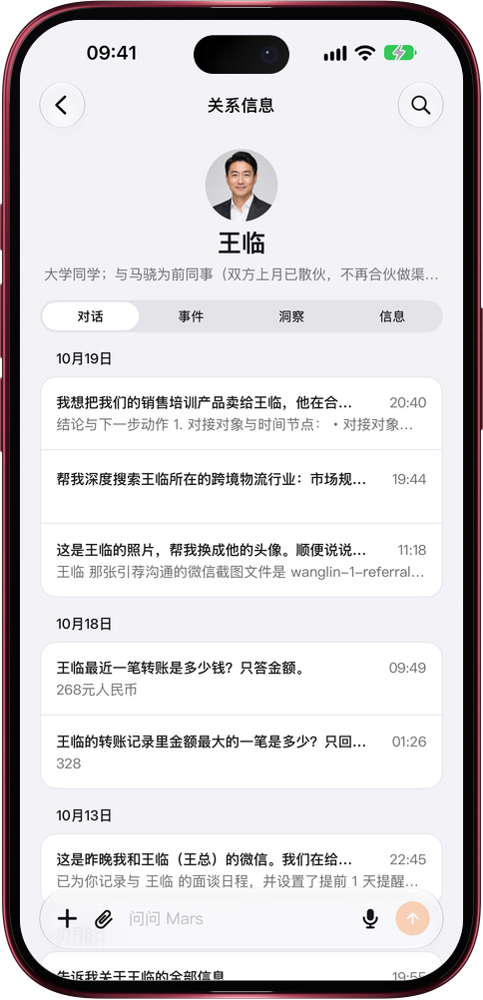

*产品实际界面 · 虚构演示数据。*

### 它给答案，而不是向你提问

欢迎页打开时分析已经做完了：谁最近冷下来了、还有哪些承诺没兑现、刚认识的人里谁最值得继续跟进。在对话里用
`@` 提到某个人，Mars 读取的是这个人的结构化档案——字段、最近往来、账本——你一分钟前刚修正的信息，下一句
回答里就会体现。

## 它的能力范围

| | |
|---|---|
| **记忆** | 自动从对话中提取五类知识——关系、记忆、经验、日志、技能——完全无需手动录入 |
| **输入** | 全模态：文字、图片、视频、语音消息，以及 PDF、表格等文档；也可以粘贴链接或分享截图 |
| **多步任务** | 描述目标即可，Mars 会拆解成步骤、自主执行，并在每个关键节点汇报；复杂策略问题可切换深度模式 |
| **数据来源** | 抖音与微信视频号的直播、短视频数据，以及通过云端浏览器采集任意网站 |
| **语言** | English、简体中文、繁體中文（香港）——产品界面、官网页面与关系相关视图均已完整支持 |
| **平台** | 任意现代浏览器，可安装为 PWA，另有 iOS 原生 App |

## 隐私

所有数据都存储在你自己的隐私云空间中，用户之间完全隔离。Mars 遵循 GDPR（通用数据保护条例）标准处理数据的
收集、加工与保护，绝不会出售或向任何人共享你的数据、人物档案或对话历史。

本仓库中的每一张截图，都是运行在演示账号上的产品实际界面；数据都是**虚构数据**，可识别信息已遮挡，
不包含任何真实用户信息。

## 提问

到 **[Discussions](https://github.com/Mars-CRM-Agent/marsdata-ai/discussions)** 提问——"能不能做 X"、
"Y 是怎么工作的"、"为什么它这样回答"都欢迎。回答是公开的，下一个有同样疑问的人就能直接找到。

常见问题已经整理在 **[FAQ](./FAQ.zh-CN.md)**。Bug 与功能建议请走
[Issues](https://github.com/Mars-CRM-Agent/marsdata-ai/issues/new/choose)。

## 链接

- **产品** — [marsdata.ai](https://marsdata.ai)
- **更新日志** — [每个版本具体改了什么](https://github.com/Mars-CRM-Agent/marsdata-changelog)
- **定价** — [marsdata.ai/pricing](https://marsdata.ai/pricing)
- **隐私政策** — [marsdata.ai/privacy](https://marsdata.ai/privacy)
