# Marsdata AI — 替你維護關係的 AI

**Marsdata AI**（亦稱 **Mars Agent**，或者就叫 **Mars**）專為一件大多數工具都不管的事而生：別讓重要的關係
悄悄冷掉。它不是一個要你不停餵內容的筆記應用，也不是為銷售流程設計的 CRM——它是一個 AI 助理，讀你本來就在
收發的內容，為當中每一個人建立結構化檔案，然後告訴你該聯絡誰、為甚麼。

**[到 marsdata.ai 試用](https://marsdata.ai)** · [產品更新日誌](https://github.com/Mars-CRM-Agent/marsdata-changelog) · [提問](https://github.com/Mars-CRM-Agent/marsdata-ai/discussions)

**語言：** [English](./README.md) · [简体中文](./README.zh-CN.md) · 繁體中文

---

## 產品一覽

**歡迎頁在你開口之前就把分析做完了。** 打開 Mars，答案已經在那裏：誰最近冷下來了、還有哪些承諾未兌現、
剛認識的人裏誰最值得繼續跟進。

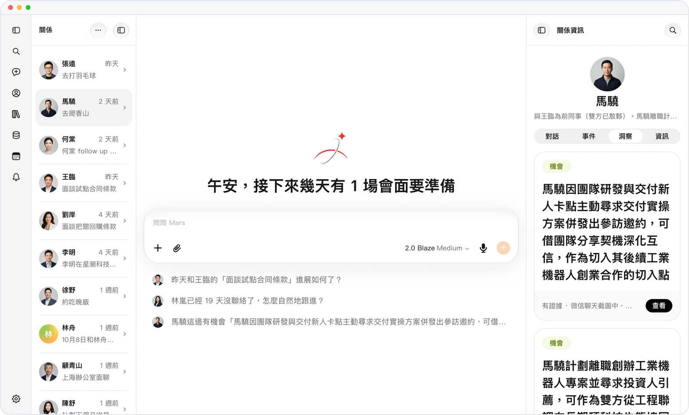 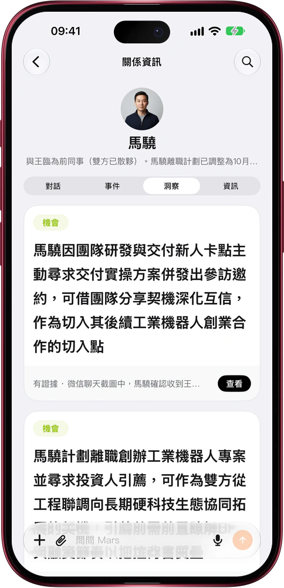

**問一個人，答案來自他的檔案。** 不是來自你當下這段對話，而是在你提問的那一刻，讀取按日期排列的互動日誌、
記錄往來的賬本和結構化欄位。

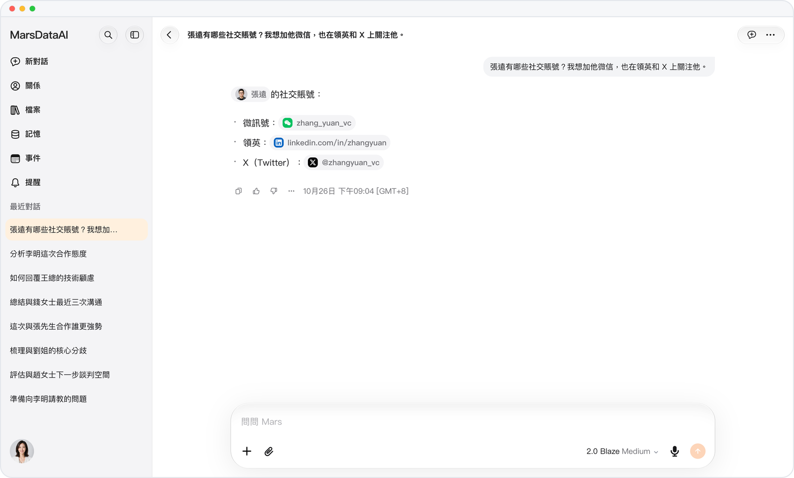 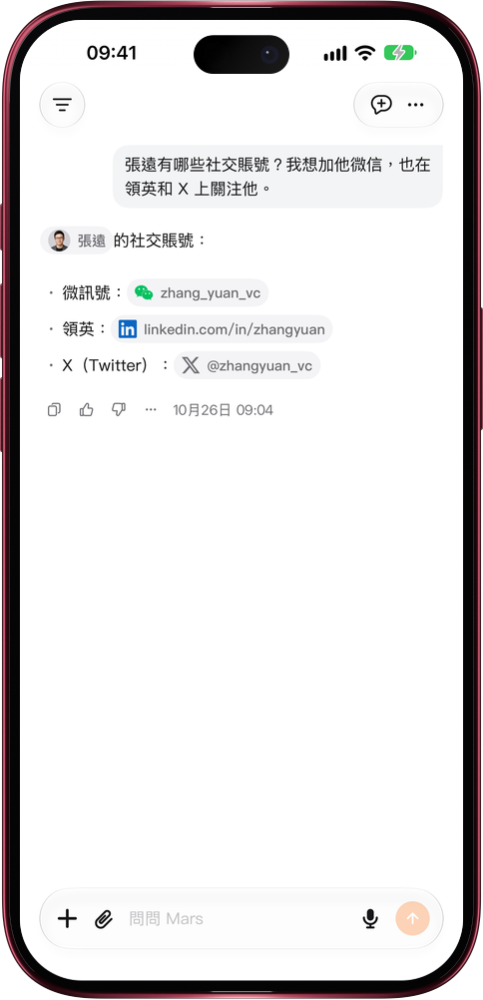

**隨口一提，日程和人脈一起更新。** 在對話中告訴 Mars 即將到來的會面，它會儲存事件並關聯參與者；按日、週、月
查看安排，同一個事件亦會出現在每位相關人物的「事件」頁。

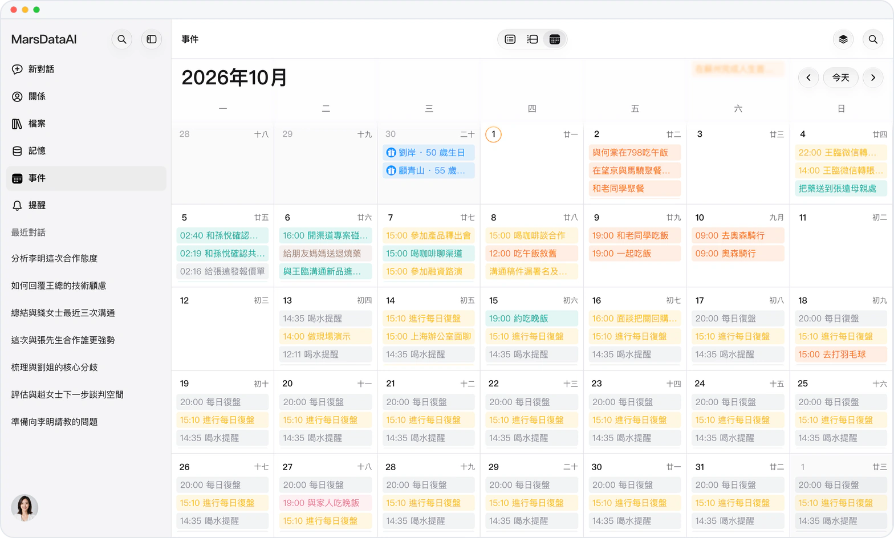 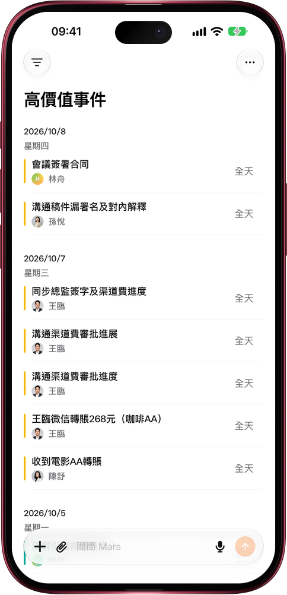

**每個人都是一份結構化檔案。** Mars 從對話中提煉的資訊歸入「基本資訊」「家庭」「人脈」「事業與團隊」
「技術與工具」「觀念與偏好」等清晰分組；這個人的對話、事件和洞察就在旁邊的分頁。

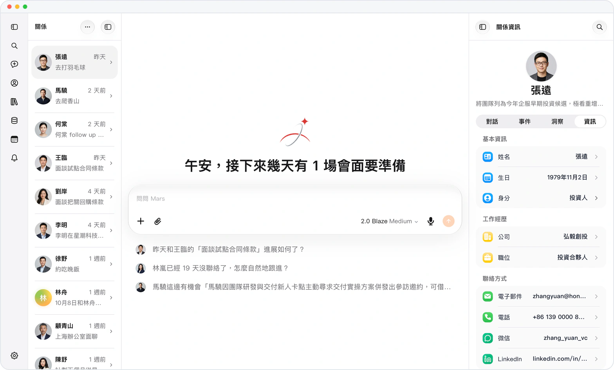 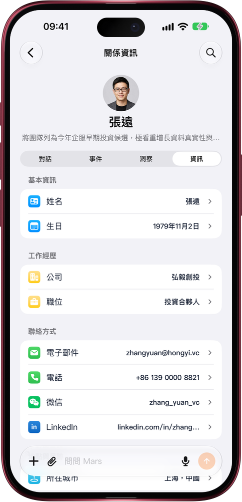

**這一切都可以隨時翻閱。** 你告訴過 Mars 的每一個人都在同一個列表裏，按最近互動排序，每人一行，寫清這段關係
目前處在哪。

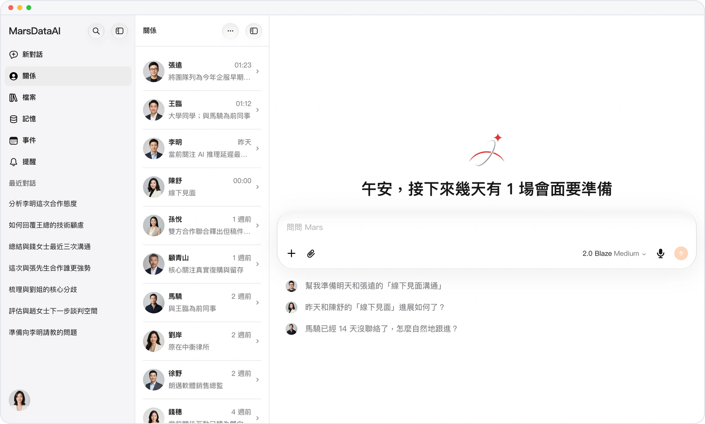 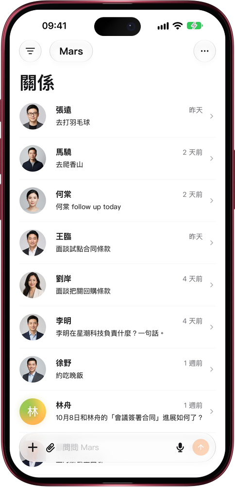

*以上為產品網頁版與 iPhone 的實際介面截圖，運行在一個使用虛構數據的示範帳號上。*

---

## 它解決的問題

每一個可能重要的人——峯會上獲引薦的投資人、認真回答過你問題的前輩、付過一次費的客戶——都由通訊軟件進來，
然後在通訊軟件裏衰減。一星期內你還記得這個人，一個月後你只記得名字，一季之後你要往回翻一整年的紀錄，
才拼得出你欠他甚麼、他說過會做甚麼。

關係維護之所以做不下去，原因很樸素：紀錄成本永遠是你在**事前**、**每一次**都要付的。Marsdata 把這筆成本
交給機器。

## 它具體做甚麼

### 每個人都成為一份結構化檔案

你告訴 Mars 一個人，或者直接轉發一段對話，它就為這個人建立一份檔案：結構化欄位、按日期排列的互動日誌、
記錄往來的帳本，以及完整的變更紀錄。每條資訊都是獨立欄位——改一條只改這一條；刪一條，這個人以及其餘資訊、
歷史紀錄原樣保留。

### 機會和風險，它先替你看見

你日常聊天或上載會議轉錄時，Mars 自動識別與相關人物有關的合作機會、潛在風險和重要訊號。每一條都放在這個人的
「洞察」頁，附帶證據鏈——原始引述和來源對話——還能按種類和狀態篩選，你要的那條機會不會淹沒在列表裏。

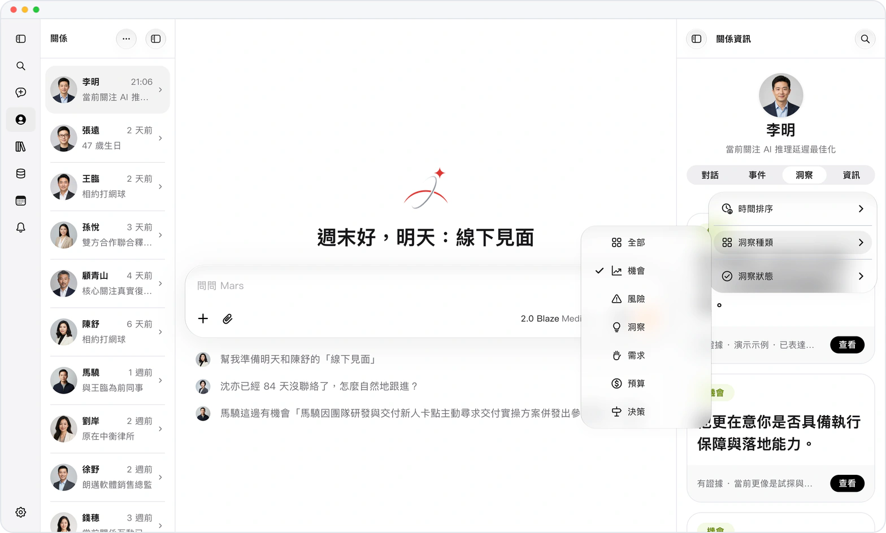 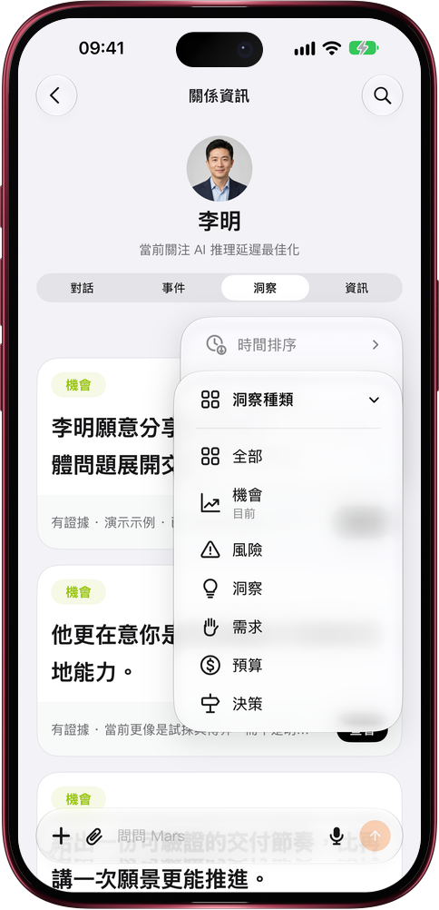

*產品實際介面 · 虛構示範數據。*

### 它讀你本來就有的對話

發一張對話或轉帳截圖，裏面的事實會自動沉澱進這個人的檔案——包括完全不涉及金額的往來。你不需要把發生過的
事再複述一次，轉發就夠了。每條資訊都有出處：人物檔案的「對話」頁列出所有提到這個人的對話和會議轉錄，
點一下就回到原話。

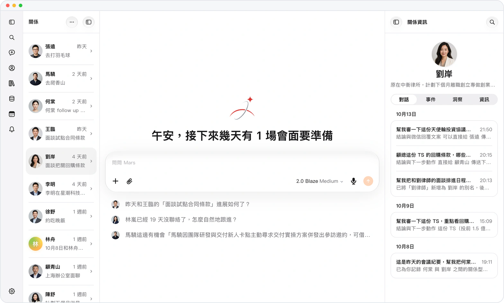 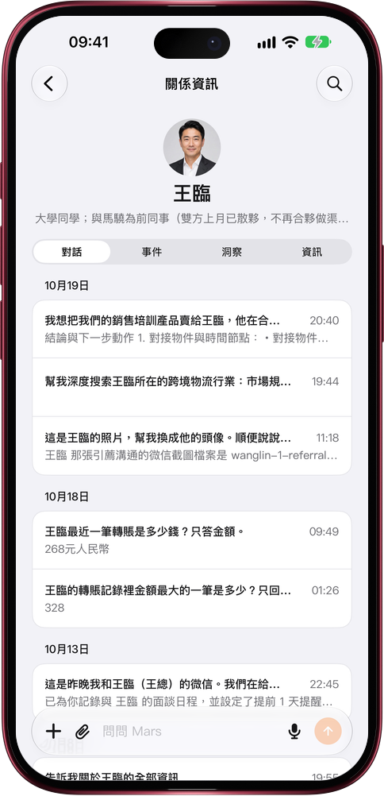

*產品實際介面 · 虛構示範數據。*

### 它給答案，而不是向你提問

歡迎頁打開時分析已經做完了：誰最近冷下來了、還有哪些承諾未兌現、剛認識的人裏誰最值得繼續跟進。在對話裏用
`@` 提到某個人，Mars 讀取的是這個人的結構化檔案——欄位、最近往來、帳本——你一分鐘前才修正的資訊，下一句
回答就會反映出來。

## 它的能力範圍

| | |
|---|---|
| **記憶** | 自動從對話中提取五類知識——關係、記憶、經驗、日誌、技能——完全毋須手動輸入 |
| **輸入** | 全模態：文字、圖片、影片、語音訊息，以及 PDF、試算表等文件；亦可貼上連結或分享截圖 |
| **多步任務** | 描述目標即可，Mars 會拆解成步驟、自主執行，並在每個關鍵節點匯報；複雜策略問題可切換深度模式 |
| **數據來源** | 抖音與微信視頻號的直播、短影片數據，以及透過雲端瀏覽器擷取任何網站 |
| **語言** | English、简体中文、繁體中文（香港）——產品介面、官網頁面與關係相關視圖均已完整支援 |
| **平台** | 任何現代瀏覽器，可安裝為 PWA，另有 iOS 原生 App |

## 私隱

所有數據都存放在你自己的私人雲端空間，用戶之間完全隔離。Mars 遵循 GDPR（通用數據保障條例）標準處理數據的
收集、處理與保護，絕不會出售或向任何人分享你的數據、人物檔案或對話紀錄。

本倉庫中的每一張截圖，都是運行在示範帳號上的產品實際介面；數據都是**虛構數據**，可辨識資訊已遮蔽，
不包含任何真實用戶資訊。

## 提問

到 **[Discussions](https://github.com/Mars-CRM-Agent/marsdata-ai/discussions)** 提問——「能不能做 X」、
「Y 是怎樣運作的」、「為甚麼它這樣回答」都歡迎。回答是公開的，下一個有同樣疑問的人就能直接找到。

常見問題已整理在 **[FAQ](./FAQ.zh-HK.md)**。Bug 與功能建議請走
[Issues](https://github.com/Mars-CRM-Agent/marsdata-ai/issues/new/choose)。

## 連結

- **產品** — [marsdata.ai](https://marsdata.ai)
- **更新日誌** — [每個版本具體改了甚麼](https://github.com/Mars-CRM-Agent/marsdata-changelog)
- **定價** — [marsdata.ai/pricing](https://marsdata.ai/pricing)
- **私隱政策** — [marsdata.ai/privacy](https://marsdata.ai/privacy)
